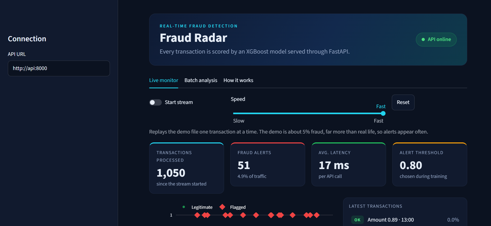
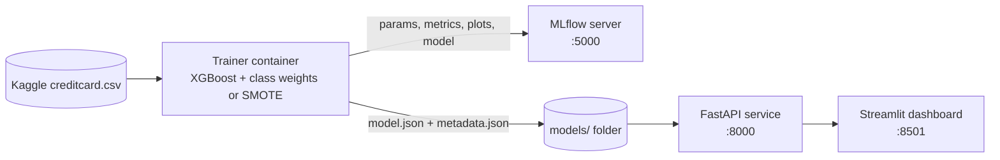
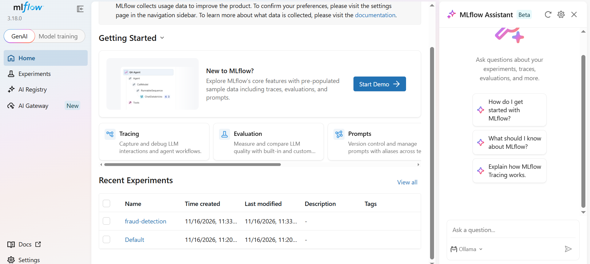
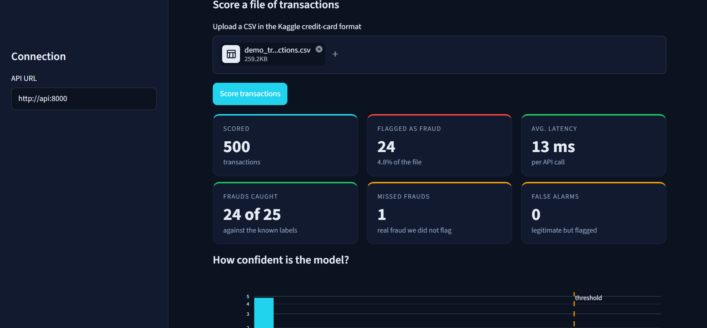

# Fraud Radar: Real-Time Credit Card Fraud Detection

An end-to-end machine learning pipeline: an XGBoost model trained on the Kaggle credit card
fraud dataset, tracked with MLflow, served through FastAPI, visualized in a Streamlit
dashboard, and packaged with Docker Compose so the whole system starts with a few commands.



## What it does

- **Trains** a fraud classifier on a heavily imbalanced dataset (only 0.17% of transactions are fraud).
- **Tracks** every experiment (parameters, metrics, plots, model) in MLflow.
- **Serves** the model as a REST API that scores a transaction in milliseconds.
- **Shows** it working in a dashboard with a live transaction stream, batch scoring and charts.

## Architecture



| Part | Tool | Folder |
|---|---|---|
| Training and experiment tracking | XGBoost, scikit-learn, imbalanced-learn, MLflow | `model_training/` |
| Prediction service | FastAPI, Pydantic, Uvicorn | `api/` |
| Dashboard | Streamlit, Plotly | `frontend/` |
| MLflow server | MLflow | `mlflow_server/` |
| Orchestration | Docker Compose | `docker-compose.yml` |

## Results

Measured on a held-out test set (20% of the data, about 57,000 transactions of which 98 are fraud):

| Metric | Value |
|---|---|
| AUPRC (main metric) | 0.873 |
| Precision | 0.93 |
| Recall | 0.81 |
| F1 | 0.86 |



### Design decisions

- **AUPRC, not accuracy.** With 0.17% fraud, a model that always answers "not fraud" is 99.8% accurate
  and useless. AUPRC (area under the precision-recall curve) rewards finding fraud without raising
  false alarms. XGBoost's early stopping watches it directly.
- **Three-way stratified split** (60% train, 20% validation, 20% test) with `StratifiedShuffleSplit`,
  so every split keeps the same fraud ratio.
- **No data leakage.** SMOTE is applied to the training set only. The decision threshold is tuned on
  the validation set, and the test set is used exactly once at the end.
- **SMOTE vs. class weights.** I compared both: test AUPRC was 0.877 (SMOTE) against 0.878 (class
  weights), effectively tied. The served model uses class weights because it is simpler and needs no
  synthetic data.
- **Model and threshold travel together.** Training saves `model.json` and `metadata.json` (decision
  threshold and feature order), so the API makes the same decisions as the evaluation.

## Quick start

Requirements: Docker Desktop, and Python with `pandas` (only to create the demo file).

1. Download `creditcard.csv` from
   [Kaggle](https://www.kaggle.com/datasets/mlg-ulb/creditcardfraud) and place it in `data/`.
2. Create the small demo file used by the dashboard:
   ```bash
   pip install pandas
   python model_training/make_demo_csv.py
   ```
3. Start MLflow, then train (this logs to MLflow and saves the model into `models/`):
   ```bash
   docker compose up -d --build mlflow
   docker compose --profile train run --rm trainer --no-use-smote
   ```
   Leave out `--no-use-smote` to train with SMOTE instead.
4. Start everything:
   ```bash
   docker compose up -d --build
   ```

| Service | Address |
|---|---|
| Dashboard | http://localhost:8501 |
| API docs (Swagger) | http://localhost:8000/docs |
| MLflow | http://localhost:5000 |

Stop everything with `docker compose down` (MLflow history is kept in a Docker volume).

## API

`POST /predict` takes the 28 anonymized features (`V1` to `V28`), `Amount` and `Hour` (0 to 23), and returns:

```json
{ "fraud_probability": 0.9992, "is_fraud": true, "threshold": 0.81 }
```

`GET /health` reports whether the model is loaded. Requests are validated with Pydantic, so
malformed input is rejected with a clear error.

## Dashboard

- **Live monitor:** replays transactions through the API with live counters, alerts, a probability
  chart and per-request latency.
- **Batch analysis:** upload a CSV, score it, and inspect flagged transactions.
- **How it works:** a short tour of the pipeline.



## Limitations

- The live stream **replays a demo file** (500 transactions, about 5% fraud) rather than reading a real
  payment feed. Some demo rows were also seen during training, so its scores look better than real use.
  The held-out test numbers above are the honest measure.
- The dataset's features are anonymized (PCA output), so model explanations are limited.
- No authentication, monitoring or drift detection yet.

## Possible next steps

Automated tests and CI, data drift monitoring, a message-queue input for true streaming, and
probability calibration.

## Project structure

```
fraud-detection/
├── api/                 FastAPI service and Dockerfile
├── frontend/            Streamlit dashboard and Dockerfile
├── model_training/      train.py, demo data script, Dockerfile
├── mlflow_server/       MLflow server Dockerfile
├── .streamlit/          dashboard theme
├── docs/images/         screenshots
├── docker-compose.yml
└── data/, models/       local only (not committed)
```